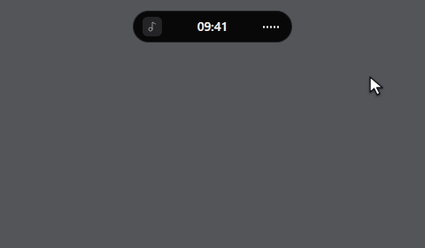
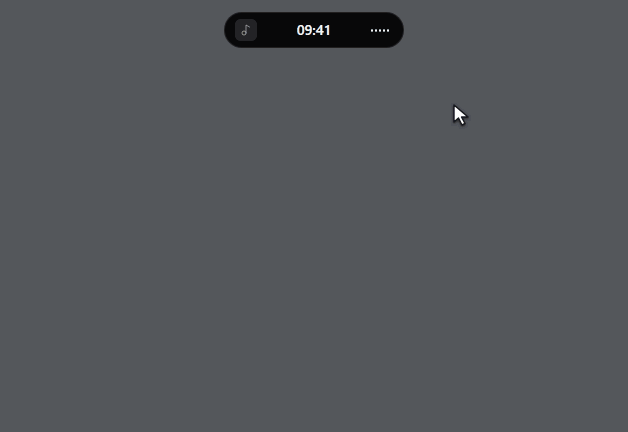

# Dynamic Island Lite

[English](README.md) · Deutsch

**[Windows-x64-Installer herunterladen (v1.0.0-alpha.4)](https://github.com/FR4T3LL0/Dynamic-Island-Lite/releases/download/v1.0.0-alpha.4/DynamicIslandLite_1.0.0-alpha.4_x64-setup.exe)**

Eine kompakte Leiste am oberen Bildschirmrand für Windows x64.

## Funktionen

### Medien steuern

Fahre mit der Maus über die Leiste, um den aktuellen Titel zu sehen. Ein Klick auf die Vorschau öffnet den Player. Dort kannst du die Wiedergabe steuern, die Lautstärke ändern und den optionalen Visualizer nutzen.



### Kalender und Timer

Klicke auf die Uhr, um den Monatskalender zu öffnen. Stelle einen Countdown ein oder wechsle für Fokusphasen und Pausen zu Pomodoro.



Beide Demos verwenden Beispieldaten.

### Anzeige und Bedienung

Wähle den Monitor, die Bewegung der Uhr und ein Tastenkürzel. Mit Smart und Peek stellst du ein, wann die Leiste erscheint.

## Installieren

1. Stelle sicher, dass die [Microsoft Edge WebView2 Evergreen Runtime](https://learn.microsoft.com/de-de/microsoft-edge/webview2/concepts/distribution) installiert ist.
2. Lade das Windows-x64-Setup unter [Releases](https://github.com/FR4T3LL0/Dynamic-Island-Lite/releases) herunter und starte es in deinem Windows-Konto.

Mit **Strg+Alt+Umschalt+I** öffnest du die Leiste. Neue Profile starten standardmäßig mit Windows. Das kannst du in den Einstellungen unter **Mit Windows starten** abschalten.

Wähle beim Update denselben Installationsordner, um App-Daten und Autostart-Einstellungen zu behalten. Deinstalliere die bisherige Version zuerst, wenn sie aus der Zeit vor der Setup-Registrierung stammt, eine andere App-Kennung nutzt oder du den Installationsordner wechseln willst. Die Deinstallation bietet eine separate Option zum Löschen der App-Daten.

## Aus dem Quellcode bauen

Führe unter Windows x64 mit Node.js 22.12+, Rust 1.96+ und den MSVC-Buildtools diese Befehle aus.

```powershell
npm.cmd ci
npm.cmd run app:build
```

Der Installer liegt unter `src-tauri/target/release/bundle/nsis`.

<details>
<summary>Entwicklungsprüfungen</summary>

```powershell
npm.cmd run lint
npm.cmd run test:unit
cargo test --manifest-path src-tauri/Cargo.toml --workspace --locked --features custom-protocol
```

</details>

## Lizenz

[MIT](LICENSE) · [Drittanbieterhinweise](src-tauri/windows/third-party/THIRD-PARTY-NOTICES.md)
