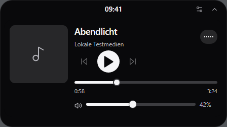
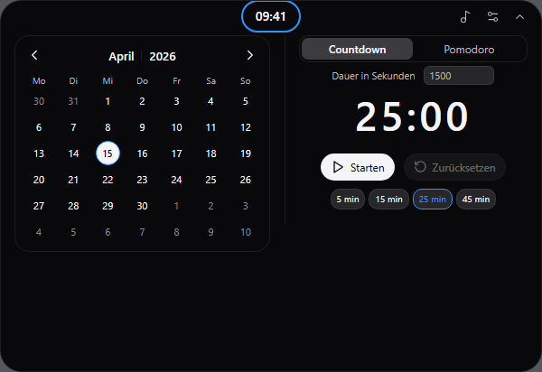

# Dynamic Island Lite

English · [Deutsch](README.de.md)

**[Download the Windows x64 installer (v1.0.0-alpha.4)](https://github.com/FR4T3LL0/Dynamic-Island-Lite/releases/download/v1.0.0-alpha.4/DynamicIslandLite_1.0.0-alpha.4_x64-setup.exe)**

A compact desktop overlay for Windows x64. Open the media player from the cover or media preview, or click the clock to access the calendar, countdown and Pomodoro timer.

<p>
  
  
</p>

The screenshots show the German interface with demo data.

## Install

1. Make sure [Microsoft Edge WebView2 Evergreen Runtime](https://learn.microsoft.com/en-us/microsoft-edge/webview2/concepts/distribution) is installed.
2. Download the Windows x64 setup from [Releases](https://github.com/FR4T3LL0/Dynamic-Island-Lite/releases) and run it from your Windows account.

Press **Ctrl+Alt+Shift+I** to open the overlay. New profiles start with Windows by default. Turn this off under **Mit Windows starten** in Settings.

For updates, select the same installation folder to keep your app data and autostart settings. Uninstall the existing copy first if it predates setup registration, uses a different app ID or needs to move to another folder. The uninstaller gives you a separate option to delete app data.

## Build from source

On Windows x64 with Node.js 22.12+, Rust 1.96+ and MSVC Build Tools, use the following commands.

```powershell
npm.cmd ci
npm.cmd run app:build
```

The installer is created in `src-tauri/target/release/bundle/nsis`.

<details>
<summary>Development checks</summary>

```powershell
npm.cmd run lint
npm.cmd run test:unit
cargo test --manifest-path src-tauri/Cargo.toml --workspace --locked --features custom-protocol
```

</details>

## License

[MIT](LICENSE) · [Third-party notices](src-tauri/windows/third-party/THIRD-PARTY-NOTICES.md)
